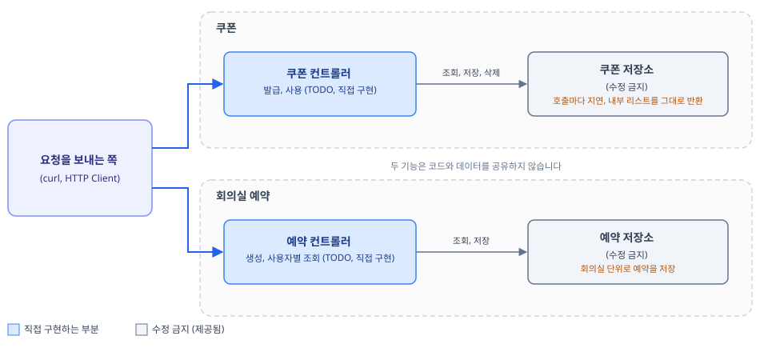

# 쿠폰 사용과 회의실 예약 (동시성 워밍업)

> 백엔드 사전 과제 (문서 버전 v1.2, 2026-10-20)

> [!IMPORTANT]
> **과제 시작 전 확인 사항**
> - 짧고 단순한 워밍업 과제입니다. 1~1.5시간 분량이며, 제한 시간은 없습니다.
> - API 경로, 요청 및 응답 형식은 반드시 그대로 지켜야 합니다. 이를 구현하는 방법은 자유롭게 정할 수 있습니다.

> [!TIP]
> - 처음이라면 3페이지 요약 자료 [`docs/requirements-overview.pdf`](docs/requirements-overview.pdf)로 전체 흐름을 먼저 본 뒤, 이 문서를 처음부터 끝까지 읽어 주세요.
> - 세부 요구사항은 이 문서를 기준으로 합니다.

## 과제 개요

- 서로 독립된 두 기능인 쿠폰 사용과 회의실 예약을 구현합니다.
- 이 과제에서는 두 가지를 봅니다.
  - 동시에 요청이 와도 한 번만 처리되어야 하는 것이 무엇인지 찾아내는지
  - 락을 꼭 필요한 범위에만 거는지
- 시작 프로젝트에는 `// TODO` 주석이 달린 빈 메서드 4개와, 수정할 수 없는 데이터 저장소 클래스 2개(`CouponStore`, `ReservationStore`)가 들어 있습니다.
- 기술 스택은 Java 17, Spring Boot 4.1.1, Gradle이며 DB는 사용하지 않습니다.

## 목차

- [과제 저장소 구성](#과제-저장소-구성)
- [1. 과제 소개](#1-과제-소개)
- [2. 구현 범위와 제공 자료](#2-구현-범위와-제공-자료)
- [3. 시작하기](#3-시작하기)
- [4. 용어 설명](#4-용어-설명)
- [5. 쿠폰 API 명세](#5-쿠폰-api-명세)
- [6. 회의실 예약 API 명세](#6-회의실-예약-api-명세)
- [7. 시나리오 체크리스트](#7-시나리오-체크리스트)
- [8. 제출 방법](#8-제출-방법)
- [9. 평가 안내](#9-평가-안내)
- [10. 힌트](#10-힌트)

---

## 과제 저장소 구성

| 파일 및 폴더 | 용도 |
|---|---|
| `README.md` | 이 문서. 과제 설명, API 명세, 시나리오, 힌트 |
| [`docs/requirements-overview.pdf`](docs/requirements-overview.pdf) | 3페이지 분량의 과제 요약 자료 |
| `starter-project/` | 과제를 시작할 프로젝트. `TODO`가 있는 컨트롤러 2개와 수정할 수 없는 데이터 저장소 클래스 2개가 들어 있습니다. **이 폴더가 제출 저장소의 최상위가 됩니다.** |
| `requests.http` | 요청 예시 (IntelliJ HTTP Client 형식). 동시 요청 시나리오용 셸 명령 예시도 들어 있습니다. |

## 1. 과제 소개

서로 관계없는 작은 문제 두 개를 풉니다.

1. **쿠폰**: 사용자는 쿠폰을 여러 장 가질 수 있습니다. 쿠폰 사용 요청에 금액을 보내면, 할인액이 가장 큰 쿠폰 1장이 자동으로 적용됩니다. 같은 쿠폰이 두 번 사용되면 안 됩니다.
2. **회의실 예약**: 같은 회의실을 겹치는 시간에 두 번 예약할 수 없습니다.

두 문제 모두 먼저 확인한 뒤 저장하는 구조입니다.

- 쿠폰은 보유 쿠폰을 조회한 뒤 하나를 골라 삭제합니다.
- 예약은 겹치는 예약이 있는지 조회한 뒤 저장합니다.
- 요청이 동시에 들어오면, 조회한 내용이 저장(삭제)하기 전에 이미 바뀌어 있을 수 있습니다.

> [!TIP]
> - 중복되면 안 되는 것은 쿠폰 한 장(예약은 같은 회의실의 겹치는 시간)입니다.
> - 하지만 어떤 쿠폰을 쓸지, 시간이 겹치는지 판단하려면 그 사용자의 쿠폰 전체(그 회의실의 예약 전체)를 봐야 합니다.
> - 그래서 무엇을 기준으로 잠글지가 이 과제의 주요 판단입니다. 다른 사용자나 다른 회의실의 요청까지 기다리게 하면 안 됩니다.

## 2. 구현 범위와 제공 자료

제공되는 것

- 시작 프로젝트
  - `TODO`가 있는 컨트롤러 2개 (`CouponController`, `ReservationController`)
  - 수정할 수 없는 데이터 저장소 클래스 2개 (`CouponStore`, `ReservationStore`)
- 이 문서

직접 해야 하는 것

- `TODO` 4개 구현: 쿠폰 발급, 쿠폰 사용, 예약 생성, 사용자별 예약 조회

조건

- 서버는 1대이며, 외부 서비스는 없습니다.
- DB 없이 메모리에만 저장합니다.

> [!IMPORTANT]
> **수정하면 안 되는 것**
> - 클래스 5개: `CouponStore`, `Coupon`, `CouponType`, `ReservationStore`, `Reservation`
> - API 경로와 요청 및 응답 형식, 에러 코드(`ErrorCode`)와 에러 응답(`ErrorResponse`)
>
> 그 밖의 부분은 자유롭게 수정하고 클래스를 추가해도 됩니다. 저장소 클래스의 메서드는 호출해도 됩니다.

쿠폰과 회의실 예약은 서로 독립된 문제입니다. 한쪽을 풀지 못해도 다른 쪽 채점에는 영향이 없습니다. 아래 그림은 두 기능의 구조입니다.



## 3. 시작하기

JDK 17이 필요합니다. Docker나 다른 서버는 필요하지 않습니다.

1. `starter-project/`를 IntelliJ에서 엽니다.
2. 서버를 실행합니다. 서버는 `8080` 포트에서 실행됩니다.
   ```bash
   ./gradlew bootRun
   ```

## 4. 용어 설명

| 용어 | 뜻 |
|---|---|
| **확인 후 실행 (check-then-act)** | 조건을 먼저 확인하고 그 결과에 따라 처리하는 코드 패턴. 확인과 처리 사이에 다른 요청이 끼어들면 확인 결과가 틀려질 수 있습니다. |
| **락 (잠금)** | 코드의 특정 부분을 한 번에 한 요청만 실행하도록 하는 장치 |
| **락의 범위** | 무엇을 기준으로 잠그는지를 말합니다. 범위가 너무 넓으면(예: 전체를 락 하나로 잠금) 관계없는 요청까지 기다려야 합니다. |
| **정률 쿠폰 / 정액 쿠폰** | 정률 쿠폰(`PERCENT_15`, `PERCENT_5`)은 금액의 일정 비율을, 정액 쿠폰(`WON_3000`, `WON_800`)은 정해진 금액을 할인합니다. |
| **시간 구간이 겹침** | 두 예약 시간이 일부라도 겹치는 것. 10시\~11시와 11시\~12시처럼 끝과 시작이 맞닿기만 한 경우는 겹치지 않습니다. |

---

## 5. 쿠폰 API 명세

### 5-1. 쿠폰 발급

`POST /api/users/{userId}/coupons`

```json
{ "type": "PERCENT_15" }
```

- 쿠폰 종류는 아래 4개뿐입니다(`CouponType`은 수정하지 않습니다).
  - `PERCENT_15`: 15% 할인
  - `PERCENT_5`: 5% 할인
  - `WON_3000`: 3,000원 할인
  - `WON_800`: 800원 할인

| 상황 | 상태 코드 | 본문 |
|---|---|---|
| 발급 성공 | **204** | 없음 |
| 잘못된 `type` | **400** | `{"code":"INVALID_REQUEST","message":"..."}` |

### 5-2. 보유 쿠폰 조회 (이미 구현됨, 응답 형식 변경 금지)

`GET /api/users/{userId}/coupons`

```json
[{"id":1,"type":"PERCENT_15"},{"id":2,"type":"WON_800"}]
```

- 보유한 쿠폰이 없으면 빈 배열을 응답합니다.

### 5-3. 쿠폰 사용

`POST /api/users/{userId}/coupons/use`

```json
{ "amount": 10000 }
```

**규칙**

- 서버가 사용자의 보유 쿠폰 중 **이 금액에 적용했을 때 할인액이 가장 큰 쿠폰 1장**을 골라 적용합니다.
  - 할인액이 같은 쿠폰이 여러 장이면 어느 쿠폰을 써도 됩니다.
  - 할인액이 0원이어도 보유 쿠폰이 있으면 1장을 적용하고 삭제합니다.
- 정률 쿠폰의 할인액은 `금액 × 할인율`에서 원 단위 미만을 버린 값입니다.
- 정액 쿠폰의 할인액은 `min(정액, 금액)`, 즉 둘 중 작은 값입니다. 최종 금액이 음수가 되지 않게 하기 위해서입니다.
- 적용된 쿠폰은 **삭제되며**, 다시 사용할 수 없습니다.

**응답**

```json
{ "originalAmount": 10000, "discountAmount": 1500, "finalAmount": 8500, "couponType": "PERCENT_15" }
```

| 상황 | 상태 코드 | 본문 |
|---|---|---|
| 성공 | **200** | 위 형식 |
| 사용할 수 있는 쿠폰이 없음 | **404** | `{"code":"NO_COUPON_AVAILABLE","message":"..."}` |
| `amount`가 0 이하 | **400** | `{"code":"INVALID_REQUEST","message":"..."}` |

---

## 6. 회의실 예약 API 명세

### 6-1. 예약 생성

`POST /api/reservations`

```json
{ "roomId": "R1", "userId": "U1", "from": "10:00", "to": "11:00" }
```

- 시각은 `HH:mm` 형식(24시간)입니다. 날짜는 다루지 않으며, 모든 예약은 하루 안의 시각으로만 표현합니다. 자정을 넘는 예약은 없습니다.
- `from`은 `to`보다 빨라야 합니다.

**같은 회의실**에서 **시간이 겹치는** 예약은 거절합니다.

- 예약 시간은 시작 시각을 포함하고 끝 시각은 포함하지 않습니다. 두 예약 a, b는 `a.from < b.to && b.from < a.to`일 때 겹칩니다.
- 끝과 시작이 맞닿기만 한 경우는 겹치지 않습니다. 10:00\~11:00과 11:00\~12:00은 둘 다 예약할 수 있습니다.

| 상황 | 상태 코드 | 본문 |
|---|---|---|
| 성공 | **201** | `{"roomId":"R1","userId":"U1","from":"10:00","to":"11:00"}` |
| 시간이 겹침 | **409** | `{"code":"TIME_CONFLICT","message":"..."}` |
| 입력 오류 (형식 오류, `from >= to`, 필수값 누락) | **400** | `{"code":"INVALID_REQUEST","message":"..."}` |

### 6-2. 회의실별 예약 조회 (이미 구현됨, 응답 형식 변경 금지)

`GET /api/reservations/rooms/{roomId}`

```json
[{"userId":"U1","from":"10:00","to":"11:00"}]
```

### 6-3. 사용자별 예약 조회

`GET /api/reservations/users/{userId}`

```json
[{"roomId":"R1","from":"10:00","to":"11:00"}]
```

- 회의실과 관계없이 해당 사용자의 예약만 모아서 응답합니다.

---

## 7. 시나리오 체크리스트

서버는 아래 모든 시나리오에서 기대 결과대로 동작해야 합니다.

| # | 시나리오 | 기대 결과 |
|---|---|---|
| S1 | 쿠폰 발급 후 사용 | 보유 쿠폰 중 **할인액이 가장 큰 쿠폰**이 적용되고 삭제됨 |
| S2 | 쿠폰 2장을 가진 사용자가 **동시에** 사용 요청 2건 | **2건 모두 성공**, 서로 다른 쿠폰이 한 장씩 사용됨 |
| S3 | 쿠폰 1장을 가진 사용자가 **동시에** 사용 요청 5건 | **1건만 성공**, 나머지 4건은 404 |
| S4 | 쿠폰이 없을 때 사용 요청 | 404 |
| S5 | 서로 다른 사용자의 사용 요청이 동시에 들어옴 | 서로 기다리지 않고 동시에 처리됨 |
| S6 | 정상 예약 | 201 |
| S7 | 앞 예약이 끝난 뒤, 같은 회의실에 시간이 겹치는 예약을 하나 더 요청 | 409 |
| S8 | 같은 회의실에 **겹치는 시간**으로 **동시에** 5건 예약 | **1건만 201**, 나머지는 409 |
| S9 | 같은 회의실에 **끝과 시작만 맞닿은** 시간으로 예약 (예: 10시\~11시, 11시\~12시) | **둘 다 201** |
| S10 | **다른 회의실**에 같은 시간으로 동시에 예약 | **둘 다 201** |
| S11 | 사용자별 예약 조회 | 해당 사용자의 예약만 조회됨 |

S3 예시: 쿠폰이 1장뿐인 사용자에게 사용 요청 5건이 동시에 들어오면 1건만 200, 나머지 4건은 404여야 합니다. 쿠폰 한 장으로 두 번 할인되면 안 됩니다.

## 8. 제출 방법

- 시작 프로젝트에서 이어서 작업합니다.
- `starter-project/` 폴더 안의 파일이 제출 저장소의 최상위에 오도록 올려 주세요. 이 장에서 말하는 루트는 이 폴더입니다.
- 루트에서 `./gradlew bootRun`으로 실행되어야 하며, 포트는 8080입니다.
- 루트에 제출 README(`README.md`)를 새로 만들고, 실행 방법과 **락을 어디에 어떻게 걸었는지, 그 이유를 3~4줄로** 적어 주세요.
- 2장의 수정하면 안 되는 것은 바꾸지 않습니다.
- 테스트 코드는 작성하지 않아도 됩니다.

## 9. 평가 안내

| 영역 | 배점 | 내용 |
|---|---|---|
| A. 정확성 | 70 | 쿠폰 시나리오(S1\~S5) 35점, 회의실 예약 시나리오(S6\~S10) 35점 |
| B. 코드 품질 | 30 | 락의 범위, 로직을 컨트롤러에 두지 않고 서비스 클래스로 분리했는지, 코드 구조의 가독성, 제출 README 설명 |
| **합계** | **100** | |

- S11(사용자별 예약 조회)은 동시성과 관계없는 단순 조회라 배점에 넣지 않았습니다. 다만 `TODO`이므로 구현해 주세요.

> [!WARNING]
> 다음 경우에는 크게 감점됩니다.
> - 같은 쿠폰이 두 번 사용됨
> - 같은 회의실에 겹치는 예약이 동시에 두 건 이상 성공함
> - 서버가 실행되지 않음

## 10. 힌트

구현하다 막혔을 때 하나씩 열어 보세요.

<details>
<summary><b>힌트 1: 무엇을 기준으로 잠글까</b></summary>
<br>

쿠폰은 사용자마다, 예약은 회의실마다 다른 락을 쓰면 어떨까요? 전체를 하나의 락으로 잠그는 것보다 어떤 점이 나은지 생각해 보세요.

</details>

<details>
<summary><b>힌트 2: 쿠폰 목록을 다룰 때 주의할 점</b></summary>
<br>

`CouponStore.findByUserId()`는 저장소 안의 리스트를 복사하지 않고 그대로 돌려줍니다. 이 리스트를 변수에 담아 두었다가 나중에 쓰면 어떤 문제가 생길 수 있을까요?

</details>

<details>
<summary><b>힌트 3: 예약 겹침</b></summary>
<br>

겹침을 확인하는 코드와 저장하는 코드가 떨어져 있으면, 그 사이에 다른 요청이 끼어들 수 있습니다. 두 코드를 어떻게 하나로 묶을 수 있을지 생각해 보세요.

</details>
